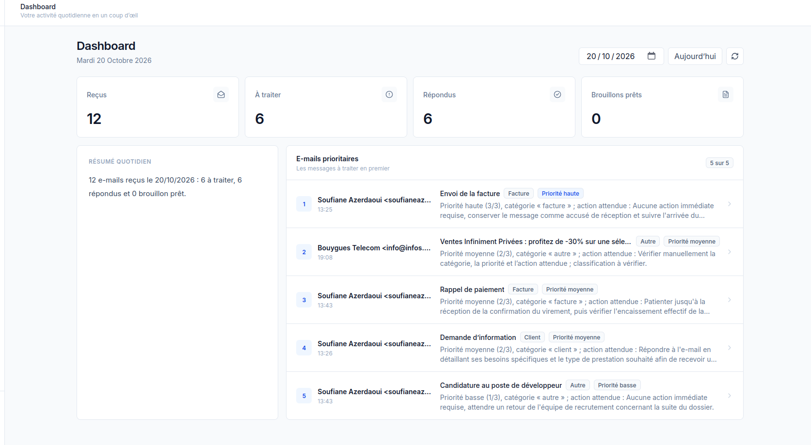
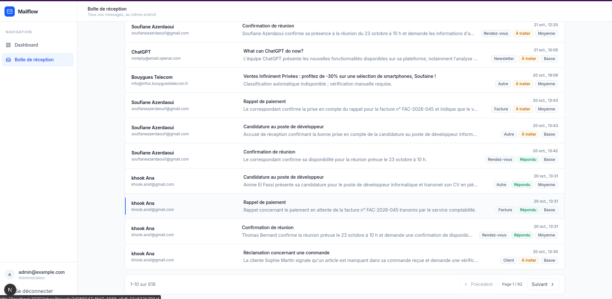
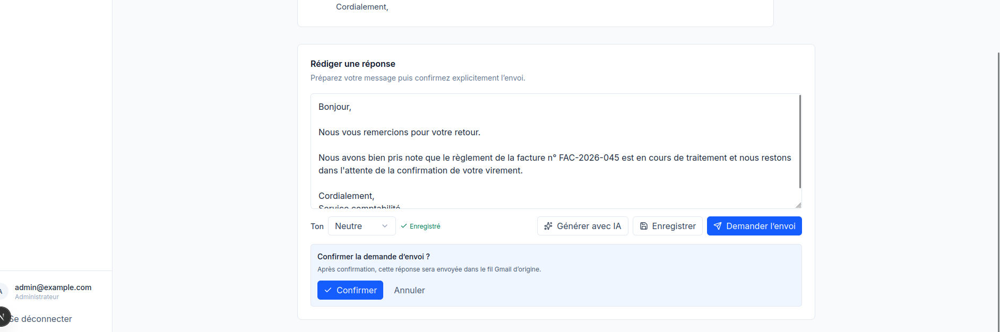
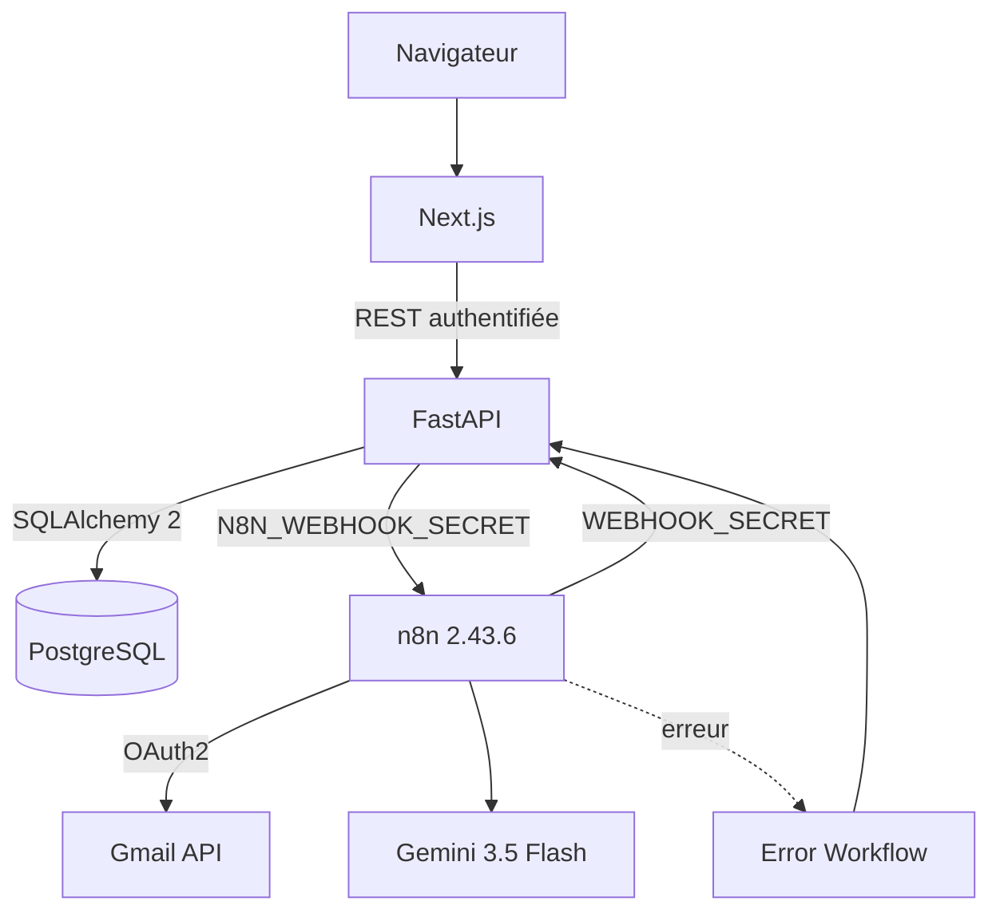
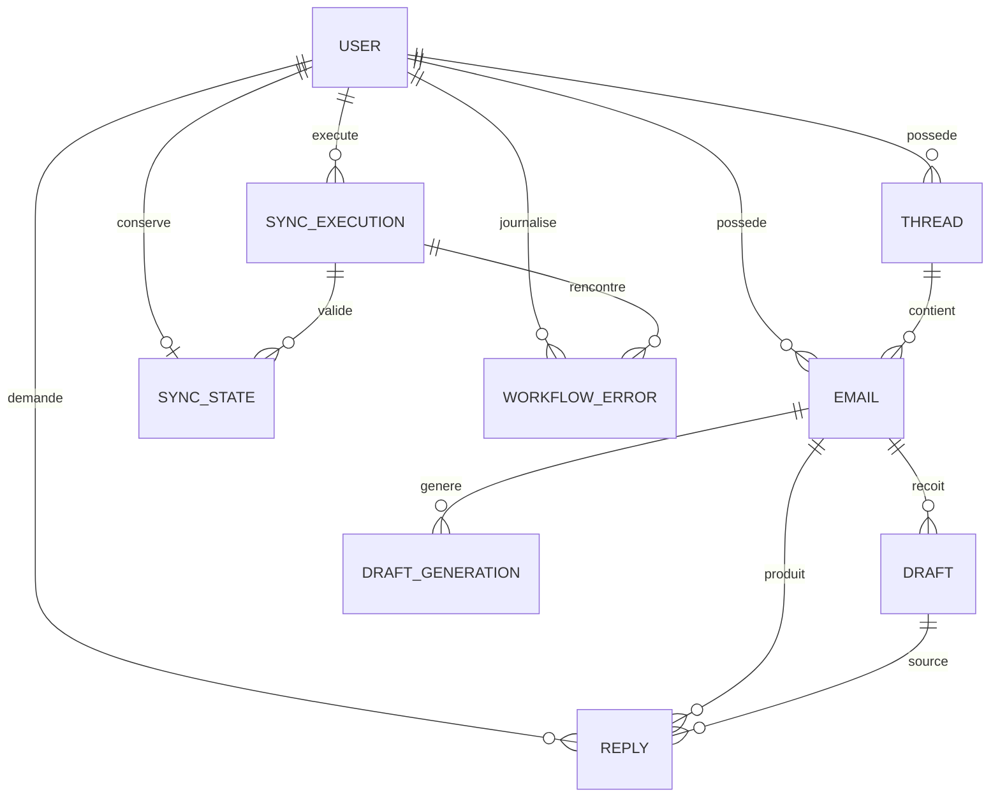

# Rapport technique final — Mailflow

## 1. Objet du projet

Le cahier des charges demande une application durable de gestion de boîte mail : une
interface responsive, une API placée entre le site et n8n, une synchronisation Gmail
incrémentale, une IA encadrée et des garanties contre les doublons et doubles envois.

Mailflow couvre ce parcours : réception des messages, classement, consultation,
préparation d'une réponse, validation humaine, demande d'envoi et retour de statut. La
source de référence est le document
[`[USTS] Exercice.pdf`](<[USTS] Exercice.pdf>).

Les objectifs obligatoires retenus sont :

- afficher, filtrer, rechercher et paginer les e-mails ;
- reconstruire chaque fil dans l'ordre chronologique ;
- fournir un résumé quotidien et cinq priorités justifiées ;
- permettre une réponse manuelle ou un brouillon IA modifiable ;
- ne jamais envoyer sans confirmation explicite ;
- synchroniser Gmail toutes les dix minutes avec pagination, curseur et lots ;
- valider les sorties IA et prévoir une reprise contrôlée ;
- sécuriser les accès, webhooks et secrets ;
- prouver l'idempotence et les comportements d'erreur par des tests.

résumé quotidien et top 5 des priorités

Boîte de réception Mailflow avec filtres et pagination

Génération et modification d'un brouillon IA

## 2. Architecture retenue

### 2.1 Frontend

Next.js sert l'interface et joue le rôle de façade côté serveur. Le JWT reçu de FastAPI
est placé dans un cookie `HttpOnly`. Les routes protégées contrôlent `/auth/me` avant de
rendre le dashboard, l'inbox ou les conversations. Les routes API Next.js transmettent
les requêtes à FastAPI ; aucun composant navigateur ne connaît l'adresse de n8n.

L'interface comprend :

- `/dashboard` : compteurs, résumé, top cinq et sélecteur de date ;
- `/inbox` : filtres combinables, recherche et pagination ;
- `/inbox/threads/{id}` : fil complet et éditeur de réponse ;
- `/login` : authentification et traitement des erreurs de session.

Le responsive est implémenté dans les composants avec Tailwind et des mises en page
adaptatives. Cette conformité est étayée par le code, le lint et le build réalisés
pendant le développement. Elle n'est pas couverte par une campagne automatisée de tests
navigateur sur plusieurs viewports ni par un test mobile physique documenté.

### 2.2 Backend

FastAPI fournit l'authentification, les API métier et les webhooks internes. Pydantic
valide les entrées et sorties. SQLAlchemy 2 gère les transactions PostgreSQL et Alembic
porte quatre migrations versionnées.

Principales routes utilisateur :

| Méthode | Route | Rôle |
|---|---|---|
| `POST` | `/auth/login` | Authentification |
| `GET` | `/auth/me` | Utilisateur courant |
| `POST` | `/auth/logout` | Révocation des JWT du compte |
| `GET` | `/emails` | Pagination, filtres et recherche |
| `GET` | `/emails/{id}` | Détail d'un message |
| `GET` | `/threads/{id}` | Conversation chronologique |
| `GET` | `/summary?date=YYYY-MM-DD` | Résumé quotidien Europe/Paris |
| `POST` | `/emails/{id}/draft` | Brouillon manuel |
| `PUT` | `/drafts/{id}` | Modification d'un brouillon |
| `POST` | `/emails/{id}/draft/generate` | Génération IA asynchrone |
| `GET` | `/draft-generations/{id}` | État de génération |
| `POST` | `/emails/{id}/reply` | Demande d'envoi confirmée |
| `GET` | `/replies/{id}` | État d'envoi |

Les webhooks internes couvrent l'import Gmail, le curseur, la classification, le
résultat de génération, le résultat Gmail Send et la journalisation des erreurs. Ils
exigent tous `X-Webhook-Secret`.

### 2.3 Modèle de données

Les identifiants Gmail de message et de fil sont uniques par utilisateur. Les clés
étrangères composites empêchent l'association d'un objet appartenant à un autre
utilisateur. Les réponses sont uniques par `(user_id, idempotency_key)` et par
identifiant Gmail une fois l'envoi confirmé. Un index partiel empêche deux générations
IA identiques simultanées pour un même utilisateur, message et ton.

### 2.4 Déploiement

`docker-compose.yml` décrit Next.js, FastAPI, PostgreSQL et n8n avec healthchecks,
volumes et réseaux séparés. PostgreSQL et n8n disposent de volumes persistants. Les
ports des services Docker sont liés à `127.0.0.1` dans cette configuration prévue. Le
backend applique Alembic au démarrage.

L'installation effectivement exploitée pendant la validation était hybride : FastAPI et
Next.js sur Ubuntu, PostgreSQL et n8n dans Docker. Selon le dernier audit, FastAPI et
Next.js écoutent encore sur toutes les interfaces de l'hôte. Le réseau PostgreSQL
`internal` décrit par le nouveau Compose n'a pas été appliqué au conteneur réel, qui n'a
volontairement pas été recréé. Le Compose complet est cohérent et validé par
`docker compose config -q`, mais son démarrage simultané depuis une machine vierge n'a
pas encore été testé de bout en bout.

## 3. Flux fonctionnels

### 3.1 Synchronisation Gmail par lots

Le workflow de production est
`n8n/workflows/gmail_sync_batch_production.json`. Son parcours est le suivant :

1. déclenchement toutes les dix minutes ou déclenchement manuel de test ;
2. lecture du curseur `historyId` et réservation d'une exécution côté FastAPI ;
3. synchronisation initiale paginée ou incrémentale par `history.list` ;
4. récupération séquentielle des détails des messages ;
5. conversion du contenu Gmail en texte lisible et normalisation ;
6. regroupement en lots de dix au maximum ;
7. import HTTP dans PostgreSQL ;
8. développement des tâches de classification retournées par FastAPI ;
9. classification séquentielle des seuls messages qui en ont besoin ;
10. validation du curseur après le succès de tous les lots uniquement.

La pause de 2,5 secondes et les reprises bornées réduisent le risque de quota. Un 404
sur `messages.get` est comptabilisé comme message disparu et n'arrête pas les autres
messages. Un curseur Gmail expiré conduit à la branche de resynchronisation complète.
Une erreur d'import non résolue arrête le workflow avant le commit.

Le mode TEST limite l'entrée à cinquante messages. Il conserve les écritures et la
déduplication, mais interdit l'avancement du curseur. Il ne s'agit pas d'un mode sans
écriture.

L'import backend utilise l'identifiant Gmail unique. Lorsqu'une réponse HTTP est perdue,
le même lot peut être renvoyé : aucun doublon n'est créé et les messages présents mais
jamais classifiés sont retournés comme tâches. Une classification terminée ou déjà
commencée n'est pas écrasée.

### 3.2 Classification Gemini

`ai_classification.json` utilise `models/gemini-3.5-flash` avec une température de
0.1. L'entrée contient l'UUID utilisateur, l'UUID e-mail, l'objet et le contenu. Le
contenu des e-mails est traité comme une donnée non fiable.

Le validateur impose :

- une catégorie parmi `client`, `facture`, `rendez-vous`, `newsletter`,
  `spam probable`, `autre` ;
- une priorité entière de 1 à 3 ;
- un résumé, une action attendue et le marqueur `needs_review`.

Un JSON initial invalide entraîne une seule nouvelle tentative. Si elle échoue, le
workflow produit `category="autre"` et `needs_review=true`. Les erreurs techniques et de
quota sont distinguées des JSON syntaxiquement invalides.

### 3.3 Génération de brouillons

FastAPI crée une `DraftGeneration` en état `pending`, réserve la génération et appelle le
webhook n8n. Le payload contient le fil, les destinataires et le ton demandé. n8n génère
le texte avec Gemini, le valide et rappelle FastAPI. Un succès crée un `Draft`
`generated_by_ai=true` ; l'utilisateur peut modifier son contenu avant l'envoi.

Les états sont `pending`, `generating`, `ready` et `failed`. L'index d'unicité partiel et
la transaction empêchent deux générations actives identiques.

### 3.4 Validation humaine et envoi Gmail

L'interface demande une confirmation explicite avant `POST /emails/{id}/reply`. FastAPI
enregistre la demande avec sa clé d'idempotence et un `dispatch_id`, puis appelle n8n.
Le frontend ne contacte jamais n8n.

Le workflow construit le message MIME avec l'expéditeur du message original comme
destinataire et transmet le `threadId` Gmail. Une réponse HTTP 200 avec un `id` Gmail
valide produit un callback `sent`. Un résultat ambigu est suspendu : il ne reboucle
jamais automatiquement vers `messages.send`.

Les états visibles sont `pending`, `sending`, `sent` et `failed`. Une reprise conserve la
clé d'idempotence. La base empêche les doubles demandes locales ; la gestion des
résultats ambigus reste indispensable, car Gmail n'offre pas de clé d'idempotence
applicative pour `messages.send`.

### 3.5 Gestion des erreurs

`workflow_error_handler.json` commence par un `Error Trigger`, ajoute la configuration
non sensible, normalise l'erreur et appelle `/internal/webhooks/workflow-errors`. La clé
d'idempotence associe workflow et exécution. Le backend conserve le workflow, le nœud et
des détails techniques bornés sans enregistrer de secret.

## 4. Choix techniques

### PostgreSQL plutôt qu'un fichier JSON

PostgreSQL apporte les transactions, index uniques, contraintes composites et verrous
nécessaires à l'idempotence concurrente. Le modèle sépare les données applicatives des
données internes de n8n.

### FastAPI entre le site et n8n

Cette séparation centralise l'autorisation, l'isolation par utilisateur et l'état métier.
n8n orchestre les services externes sans devenir la source de vérité de l'application.

### Workflows spécialisés

Synchronisation, classification, génération, envoi et erreurs sont séparés. Chaque
workflow peut être repris ou désactivé sans confondre lecture Gmail, appel IA et envoi.

### Traitement asynchrone

La génération et l'envoi retournent rapidement un état persistant. Les callbacks n8n
font évoluer cet état. Le frontend affiche le statut confirmé par le backend et ne
présente jamais `pending` comme « envoyé ».

## 5. Idempotence et concurrence

Les mécanismes principaux sont :

- unicité `(user_id, gmail_message_id)` pour les imports ;
- unicité `(user_id, gmail_thread_id)` pour les fils ;
- unicité `(user_id, idempotency_key)` pour les réponses et synchronisations ;
- `dispatch_id` vérifié lors du callback Gmail ;
- insertions PostgreSQL avec gestion de conflit ;
- bail de synchronisation contre les exécutions concurrentes ;
- commit du curseur après réussite globale uniquement ;
- callbacks répétés sans création d'un nouvel envoi ;
- absence de relance automatique après un résultat Gmail ambigu.

## 6. Tests et validation

La suite utilise `unittest`, FastAPI TestClient et une base PostgreSQL dédiée. Les tests
d'intégration sont ignorés si `TEST_DATABASE_URL` n'est pas défini, ce qui protège une
base réelle contre une exécution accidentelle.

| Campagne | Résultat |
|---|---:|
| Suite backend complète avec PostgreSQL isolé | 151 réussis |
| Validation ciblée des exports et de la sécurité | 55 réussis |

Les 55 tests ciblés recouvrent une partie de la suite ; ils ne sont pas ajoutés aux 151.

La couverture comprend notamment :

- login, JWT expiré, route protégée et logout ;
- filtres, recherche, pagination, fils et isolation ;
- journée Europe/Paris, y compris journées de 23 et 25 heures ;
- import répété et concurrent sans doublon ;
- récupération d'une classification après perte de réponse HTTP ;
- webhook sans secret ou avec mauvais secret ;
- JSON IA valide, invalide, nouvelle tentative et fallback ;
- génération concurrente, callback et erreur n8n simulée ;
- double clic, idempotence, callback Gmail répété et statut ambigu ;
- lots 1/10/15/30, échec du deuxième lot et absence de commit ;
- exports sans secret, URLs, credentials attendus et paramètres Docker.

Le lint et le build Next.js font partie de la procédure de validation. Ils n'ont pas été
relancés pendant la rédaction de ce rapport, qui ne modifie que Markdown. Aucun test
automatisé responsive multi-viewport n'est présent ; l'implémentation responsive et sa
validation automatisée doivent donc être distinguées.

## 7. Mesures de performance

### 7.1 Trente e-mails fictifs

Les trois durées confirmées sont :

| Essai | Durée |
|---:|---:|
| 1 | 2,407 s |
| 2 | 2,500 s |
| 3 | 2,405 s |
| **Médiane** | **2,407 s** |

Conditions :

- réponses Gmail simulées ;
- jeu de données fictif ;
- n8n, FastAPI et PostgreSQL isolés ;
- appels HTTP réels entre n8n et FastAPI ;
- écritures réelles dans PostgreSQL de test ;
- trois lots de dix ;
- aucun appel Gmail ou Gemini réel.

Cette mesure évalue **n8n → HTTP FastAPI → PostgreSQL**. Elle ne mesure pas une
synchronisation Gmail réelle et n'inclut ni latence Gmail, ni OAuth2, ni quota, ni temps
Gemini. Les trente messages de chaque essai sont fictifs et les réponses Gmail sont
simulées.

### 7.2 Validité JSON Gemini au premier essai

`gemini_classification_benchmark.json` reprend le prompt, le modèle et la température de
production. Il traite un essai isolé, puis des groupes de dix au maximum, avec checkpoint
et reprise. Il sépare JSON invalide, 429, 503 et autre erreur technique.

Le benchmark réel sur trente messages est **incomplet à cause du quota**. Aucun
pourcentage de réussite initiale ne peut être annoncé. Une simulation ne serait pas une
mesure du modèle et n'est pas utilisée comme résultat académique.

## 8. Sécurité et exploitation

### Protections appliquées

- Argon2 et absence d'inscription publique ;
- JWT avec expiration et révocation au logout ;
- contrôle du propriétaire sur les routes métier ;
- secrets dans `.env`, exclus de Git ;
- secrets distincts selon le sens FastAPI ↔ n8n ;
- comparaison constante du secret des webhooks ;
- credentials OAuth2 et Gemini absents des exports ;
- n8n 2.43.6 épinglé et clé persistante ;
- accès `$env` bloqué dans les nœuds ;
- ports des services Docker liés à localhost dans le Compose prévu ;
- réseau PostgreSQL `internal` défini dans le Compose prévu ;
- logs n8n au niveau `warn`, trois fichiers Docker de 10 Mo ;
- purge automatique, conservation 72 heures et maximum 500 exécutions ;
- succès, progression et exécutions manuelles non enregistrés systématiquement ;
- sauvegardes PostgreSQL et n8n chiffrées, lisibles et vérifiées.

La maintenance a recréé uniquement n8n avec `--no-deps`. La version, le volume, la clé,
les six workflows actifs, les six credentials, le planning Gmail Sync Batch et la
connexion FastAPI ont été contrôlés après redémarrage. Aucun appel Gmail ou Gemini n'a
été déclenché.

Les deux protections réseau précédentes décrivent la cible Compose. Elles ne sont pas
entièrement appliquées à l'installation hybride actuelle : FastAPI et Next.js écoutent
encore sur toutes les interfaces, et PostgreSQL réel reste sur son ancien réseau Docker
car il n'a pas été recréé pendant la maintenance.

### GitHub et collaboration

Le dépôt distant configuré est
`https://github.com/SoufianeAzerdaoui/ai-email-assistant`. L'historique Git local prouve
l'existence de Pull Requests fusionnées ; aucun numéro n'est affirmé dans ce rapport.
Les comptes `lilgar77` et `Holo795` sont les collaborateurs ajoutés selon les
informations du projet. GitHub CLI n'étant pas authentifié dans l'environnement de
validation, l'acceptation de leurs invitations n'a pas pu être vérifiée.

### Protections à finaliser

- tester le Compose complet sur une installation vierge ;
- réaliser une restauration complète dans un environnement isolé ;
- limiter FastAPI et Next.js hybrides à l'interface voulue ou appliquer un pare-feu ;
- appliquer et valider le réseau PostgreSQL interne lors d'une maintenance autorisée ;
- ajouter un reverse proxy TLS si l'application quitte localhost ;
- envisager une signature HMAC et une protection anti-rejeu des webhooks ;
- formaliser la rotation des secrets et la révocation OAuth2 ;
- comparer périodiquement workflows actifs et exports Git.

## 9. Difficultés rencontrées et solutions

- les quotas Gmail et Gemini peuvent ralentir ou
  interrompre temporairement certains traitements ;
- Mailflow a été ma première expérience avec n8n. Au début, j'ai rencontré des difficultés pour comprendre le fonctionnement des nœuds, les connexions entre les workflows et le passage des données d'un nœud à un autre.
- L'une des principales difficultés concernait la communication entre FastAPI et n8n. J'ai notamment rencontré des erreurs d'authentification HTTP 401 et 403, liées à la configuration des credentials et des secrets utilisés dans les webhooks.
- J'ai rencontré des difficultés pour faire communiquer n8n, exécuté dans Docker, avec FastAPI, exécuté directement sur Ubuntu. L'adresse localhost:8000 ne fonctionnait pas depuis le conteneur n8n, car elle désignait le conteneur lui-même et non mon ordinateur.
 **Solution** : j'ai utilisé host.docker.internal:8000 pour permettre à n8n d'accéder à FastAPI dans l'architecture hybride actuelle.
- La synchronisation Gmail a été l'une des parties les plus complexes du projet.J'ai rencontré des difficultés avec la pagination Gmail, les boucles n8n, le traitement des messages par lots et la gestion du curseur de synchronisation.

## 10. Installation résumée

La procédure détaillée est dans le [README principal](../README.md) : copie des fichiers
`.env.example`, génération des secrets, validation Compose, démarrage, création de
l'administrateur, import des cinq workflows, affectation des credentials, configuration
de l'URL backend et de l'UUID, association de l'Error Workflow, test manuel puis
activation de Gmail Sync Batch.

Après une installation neuve, les contrôles minimaux sont : santé des quatre services,
login, import d'une fixture sans doublon, brouillon modifiable, refus d'un webhook
incorrect et test d'envoi vers un compte Gmail de test après confirmation. Ce dernier
contrôle reste manuel et ne doit pas être lancé par la suite automatisée.
